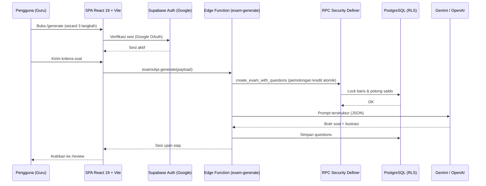
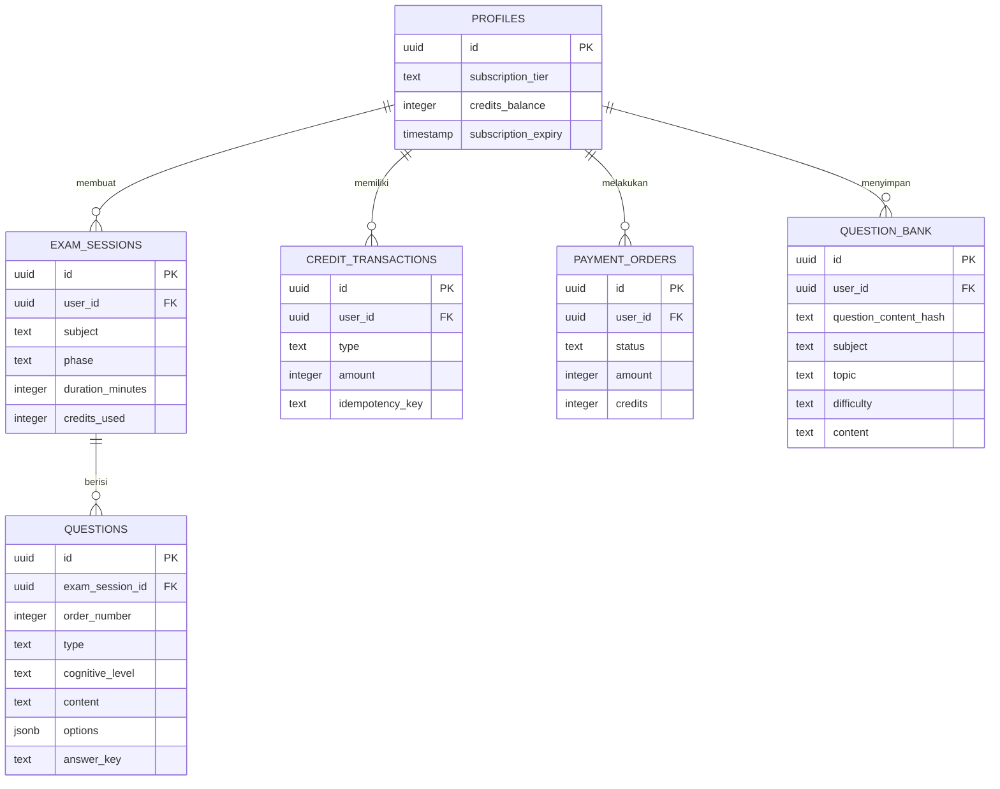

# PRD — Project Requirements Document

## 1. Overview

**Soalify** (`ardika08/buat-soal`) adalah platform pembuatan naskah soal ujian otomatis berbasis AI untuk pendidik di Indonesia. Aplikasi ini menyelesaikan masalah utama guru dalam menyusun soal ujian: proses yang memakan waktu, penyelarasan dengan kurikulum, dan penyusunan sebaran tingkat kesulitan yang konsisten.

Tujuan utama Soalify:

- **Otomasi pembuatan soal** — Menghasilkan paket soal lengkap dari topik atau dokumen referensi (PDF/teks) sesuai kurikulum, fase kelas, dan alokasi waktu.
- **Distribusi kognitif** — Menegakkan pemetaan Taksonomi Bloom (C1–C6) dan tingkat kesulitan LOTS/MOTS/HOTS, serta menyediakan analisis kualitas naskah.
- **Pengelolaan bank soal** — Menyimpan soal terverifikasi milik guru agar dapat dipakai ulang tanpa pemotongan kredit.
- **Ekspor dokumen siap cetak** — Menghasilkan naskah ujian, kunci jawaban, dan kisi-kisi dalam format PDF/DOCX.
- **Monetisasi kredit & langganan** — Pengelolaan saldo kredit, tier akun (*free*, *basic*, *premium*), dan pembayaran melalui gateway Mayar.

Dokumen ini mendokumentasikan aplikasi yang **sudah terbangun**, bukan rencana pengembangan.

## 2. Requirements

**Kebutuhan fungsional:**

- Pengguna hanya dapat mengakses halaman privat setelah login via Google OAuth.
- Setiap paket soal dibuat melalui wizard 3 langkah dengan parameter kurikulum, referensi materi, dan kriteria soal.
- Setiap generate soal memotong saldo kredit; saldo tidak mencukupi membatalkan proses.
- Semua mutasi kredit dan penyuntingan soal dieksekusi secara atomik di server (RPC *Security Definer*) untuk mencegah manipulasi dari klien.
- Penyuntingan butir soal di halaman peninjauan tersimpan otomatis (autosave ter-debounce).
- Ekspor DOCX dan kisi-kisi hanya tersedia untuk langganan aktif.
- Pembelian kredit dan paket langganan diproses melalui Mayar dengan halaman pemantauan status.

**Kebutuhan non-fungsional:**

- Otorisasi data ditegakkan di tingkat database melalui PostgreSQL Row Level Security (RLS).
- Rekonsiliasi pembayaran berjalan berkala (setiap 15 menit) melalui workflow terjadwal.
- Transaksi kredit menggunakan penguncian baris (`FOR UPDATE`) dan idempotency key.
- Fallback percobaan otomatis tersedia jika panggilan AI gagal; output soal divalidasi ketat sebelum disimpan.
- Jika statistik aplikasi gagal dimuat, bilah statistik beralih ke indikator *Offline* dan mencoba ulang setiap 10 detik.

**Batasan yang sudah ada di sistem:**

- Terdapat dua implementasi backend: Supabase (utama, diakses SPA React) dan Laravel 12 (alternatif).
- Pemilihan mesin AI disesuaikan tier akun: Google Gemini untuk pengguna *free*, OpenAI untuk *premium*.

## 3. Core Features

### Fase 1

**A. Dashboard Utama** — Halaman utama dengan ringkasan akun, saldo kredit, dan akses cepat ke seluruh menu.
- Ringkasan Saldo Kredit — Sisa kredit pengguna ditampilkan di header sehingga langsung terlihat sebelum membuat soal.
- Statistik Aplikasi — Statistik pemakaian dimuat otomatis dan diperbarui berkala oleh bilah statistik (dengan fallback *Offline* bila gagal).
- Akses Cepat Menu — Jalan pintas menuju buat soal, bank soal, riwayat ujian, dan pembelian kredit.

**B. Buat Soal Wizard** — Alur tiga langkah untuk merancang paket soal ujian baru.
- Info Dasar Ujian — Pemilihan fase kelas, mata pelajaran, semester, dan alokasi waktu ujian.
- Materi & Referensi — Sumber materi dari AI, unggahan berkas PDF, atau teks yang diketik sendiri.
- Kriteria & Tipe Soal — Pengaturan jumlah soal, distribusi tipe soal (PG, PGK, Menjodohkan, B-S, Isian, Uraian), topik, tujuan pembelajaran, dan opsi ilustrasi.
- Proses Generate AI — Validasi isian, overlay progres, pemotongan kredit, lalu pengalihan ke halaman peninjauan.

**C. Tinjau & Sunting Soal** — Halaman peninjauan hasil generate untuk menyunting, menambah, menghapus, dan meregenerasi butir soal.
- Sunting Isi Soal — Perubahan teks soal dan pilihan jawaban tersimpan otomatis ke server tanpa menekan tombol simpan.
- Tambah, Hapus, Urutkan — Menambah butir baru, menghapus butir, dan menyusun ulang nomor urut soal.
- Regenerasi Butir — Butir soal tertentu dibuat ulang oleh AI langsung dari halaman peninjauan.
- Analisis Kualitas Soal — Sistem mengevaluasi naskah dan menampilkan hasil analisis kualitas serta sebaran tingkat kognitif.

**D. Bank Soal Pribadi** — Repositori soal milik guru untuk menyimpan, mencari, dan memakai ulang butir soal terverifikasi.
- Pencarian & Filter Soal — Penyaringan soal berdasarkan mata pelajaran, fase kelas, topik, tingkat kesulitan, atau kata kunci.
- Simpan ke Bank Soal — Butir soal terpilih disimpan ke bank soal pribadi tanpa pemotongan kredit saat dipakai ulang (deduplikasi via hash konten).
- Buat Paket Baru — Soal terpilih dirangkai menjadi paket ujian baru yang langsung dibuka di halaman peninjauan.
- Gabung ke Ujian Ada — Soal terpilih ditambahkan ke paket ujian yang sudah ada dengan ringkasan jumlah soal dan duplikatnya.
- Hapus Soal Terpilih — Beberapa soal sekaligus dapat dibuang dari bank soal pribadi.

**E. Riwayat Ujian** — Daftar arsip paket soal yang pernah dibuat.
- Daftar Paket Soal — Menampilkan seluruh paket soal dengan paginasi agar mudah ditelusuri.
- Buka Kembali Ujian — Klik satu riwayat membuka kembali paket tersebut di halaman peninjauan.
- Hapus Riwayat — Penghapusan paket dilakukan melalui dialog konfirmasi sebelum data benar-benar dibuang.

**F. Ekspor Dokumen** — Mengunduh naskah ujian, kunci jawaban, dan kisi-kisi dalam format siap cetak.
- Ekspor PDF — Naskah ujian diunduh langsung dalam format PDF dari halaman peninjauan.
- Ekspor DOCX — Naskah ujian dan kunci jawaban diunduh dalam format DOCX yang bisa disunting.
- Ekspor Kisi-kisi — Tabel kisi-kisi pembelajaran disusun dan diunduh dalam format DOCX berorientasi landscape.
- Kunci Jawaban — Dokumen yang diunduh menyertakan kunci jawaban dan pembahasan tiap butir soal.
- Batasan Ekspor Premium — Ekspor DOCX dan kisi-kisi hanya berjalan untuk langganan aktif; jika tidak, muncul tawaran langganan.

**G. Beli Kredit & Langganan** — Pembelian kredit dan paket langganan melalui gateway pembayaran Mayar.
- Top-up Kredit — Pembelian paket kredit bawaan atau pengisian jumlah kredit kustom sesuai tarif yang berlaku.
- Langganan Premium — Pengaktifan paket langganan untuk membuka fitur ekspor lanjutan dan mesin AI premium.
- Checkout Mayar — Data pembeli diambil dari perangkat lalu sistem membuat sesi pembayaran di gateway Mayar.
- Status Pembayaran — Halaman pengembalian memantau status pembayaran berkala dan memperbarui saldo saat transaksi lunas.
- Riwayat Transaksi — Peninjauan log transaksi, status invoice, dan pengunduhan tanda terima pembayaran.

**H. Masuk & Akun** — Pintu masuk pengguna dengan akun Google serta perlindungan seluruh halaman privat.
- Masuk dengan Google — Pengguna masuk memakai akun Google melalui Supabase Auth (Google Identity Services).
- Perlindungan Halaman — Setiap halaman privat hanya bisa dibuka saat sesi aktif; jika tidak, pengguna dialihkan ke halaman masuk.
- Peringatan Konfigurasi — Halaman masuk menampilkan pesan khusus jika `VITE_GOOGLE_CLIENT_ID` belum tersedia di lingkungan aplikasi.
- Keluar Akun — Tombol keluar pada bilah atas mengakhiri sesi pengguna dari aplikasi.

## 4. User Flow

**A. Masuk & Perlindungan Halaman**
1. Pengguna membuka aplikasi; `ProtectedRoute` memeriksa status sesi.
2. Jika belum login, pengguna dialihkan ke `/login`.
3. Pengguna menekan tombol Google (Google Identity Services via `VITE_GOOGLE_CLIENT_ID`).
4. Setelah sukses, pengguna diarahkan ke `/dashboard`; header menampilkan saldo kredit dan tombol logout.
5. Jika `VITE_GOOGLE_CLIENT_ID` belum diatur, halaman login menampilkan state error konfigurasi.

**B. Membuat Soal (Wizard 3 Langkah)**
1. Pengguna membuka `/generate` dari dashboard.
2. **Langkah 1**: Memilih fase kelas, mata pelajaran, semester, dan alokasi waktu.
3. **Langkah 2**: Menentukan sumber materi (AI, unggah PDF, atau teks manual).
4. **Langkah 3**: Mengatur jumlah soal, distribusi tipe, topik, tujuan pembelajaran, dan opsi ilustrasi.
5. Pengguna menekan generate; sistem memvalidasi form, menyusun payload, memanggil `examsApi.generate`, menampilkan overlay progres, dan memotong kredit.
6. Pengguna diarahkan ke `/review` dengan data sesi ujian.
7. Jika kredit tidak mencukupi, proses dibatalkan dan pengguna diarahkan ke `BillingDialog`.

**C. Meninjau, Menyunting, dan Mengekspor**
1. `/review` memuat soal dari state navigasi atau query `?exam=<id>`.
2. Pengguna mengubah teks soal (autosave ter-debounce), menambah, menghapus, menyusun ulang, atau meregenerasi butir.
3. Pengguna menjalankan analisis kualitas soal.
4. Pengguna menyimpan butir terpilih ke Bank Soal.
5. Ekspor PDF langsung tersedia; ekspor DOCX dan kisi-kisi memvalidasi status premium, jika tidak akan membuka `BillingDialog`.

**D. Bank Soal & Riwayat**
- **Bank Soal** (`/question-bank`):
  1. Memuat daftar soal dengan filter (mapel, fase, topik, kesulitan, kata kunci).
  2. Pengguna memilih beberapa soal lalu memilih salah satu aksi: buat paket baru, gabung ke ujian ada, atau hapus soal terpilih.
- **Riwayat** (`/exam-history`):
  1. Menampilkan daftar paket soal dengan paginasi.
  2. Klik item riwayat membuka `/review?exam=<id>`.
  3. Hapus riwayat membuka dialog konfirmasi kemudian memanggil `examsApi.delete`.

**E. Billing & Transaksi**
1. Pengguna membuka `BillingDialog` (tab Top-up dan Subscription); data pembeli diambil dari `localStorage`.
2. Pengguna memilih paket kredit atau mengisi kredit kustom.
3. Sistem membuat sesi checkout Mayar melalui `billingApi`.
4. Setelah pembayaran, pengguna diarahkan ke `/billing/return` yang mem-polling status pembayaran dan memperbarui profil saat lunas.
5. Pengguna dapat meninjau transaksi dan mengunduh tanda terima di `/transactions`.

## 5. Architecture

Aplikasi terdiri dari **SPA React 19 + Vite** yang berinteraksi langsung dengan **Supabase** (Auth, PostgreSQL dengan RLS, RPC *Security Definer*, Storage, dan Edge Functions). Tersedia juga **backend Laravel 12 alternatif** dengan API REST + Sanctum serta service layer setara.

Alur billing menggunakan pola serupa: SPA membuat sesi pembayaran pada Edge Function `billing-checkout`, yang memanggil Mayar; rekonsiliasi berjalan berkala (setiap 15 menit) untuk memutakhirkan status order dan menambahkan kredit bila lunas.

Komponen arsitektur yang terbukti:
- **Frontend SPA** (`React 19 + Vite`) dengan `ProtectedRoute`, `AuthContext`, dan `src/lib/api.ts` sebagai API layer.
- **Supabase**: Auth (Google OAuth), PostgreSQL (tabel `profiles`, `exam_sessions`, `questions`, `credit_transactions`, `question_bank`, `payment_orders`), Row Level Security, RPC *Security Definer*, Storage bucket `question-illustrations`, dan Edge Functions `exam-generate`, `billing-checkout`, `app-stats`.
- **Laravel 12 (alternatif)**: API Router + Sanctum, controllers, service `AiQuestionGenerator`, `CreditService`, `BillingService`, `IllustrationImageGenerator`, `PromptBuilder`, `QuestionOutputValidator`.
- **Provider eksternal**: Google Gemini API, OpenAI API (teks & gambar), Mayar Payment Gateway.

## 6. Database Schema

Entitas yang terbukti disebut pada basis data Supabase:

- **profiles** — Data identitas pengguna dan status monetisasi.
  - `id` (uuid, kunci utama, referensi ke auth user)
  - `subscription_tier` (text: `free` | `basic` | `premium`)
  - `credits_balance` (integer, default 10 kredit selamat datang)
  - `subscription_expiry` (timestamp, masa kedaluwarsa langganan)

- **exam_sessions** — Konfigurasi paket ujian per sesi.
  - `id` (uuid, kunci utama)
  - `user_id` (uuid, relasi ke `profiles.id`)
  - `subject`, `phase`, `grade`, `semester`, `exam_type` (text)
  - `duration_minutes` (integer)
  - `topics` (text/jsonb)
  - `credits_used` (integer)

- **questions** — Butir soal dalam sebuah sesi ujian.
  - `id` (uuid, kunci utama)
  - `exam_session_id` (uuid, relasi ke `exam_sessions.id`)
  - `order_number` (integer, urutan soal)
  - `type` (text: PG, PGK, Menjodohkan, B-S, Isian, Uraian)
  - `cognitive_level` (text: C1–C6)
  - `content` (text, isi soal)
  - `options` (jsonb, opsi jawaban)
  - `answer_key` (text), `explanation` (text)
  - `illustration_prompt` / `illustration_url` (text)

- **credit_transactions** — Ledger mutasi kredit.
  - `id` (uuid, kunci utama)
  - `user_id` (uuid, relasi ke `profiles.id`)
  - `type` (text: `topup` | `subscription` | `deduction` | `bonus`)
  - `amount` (integer)
  - `idempotency_key` (text, kunci unik pencegahan duplikasi)

- **payment_orders** — Log pesanan gateway Mayar.
  - `id` (uuid, kunci utama)
  - `user_id` (uuid, relasi ke `profiles.id`)
  - `status` (text: `pending` | `paid` | `expired` | `failed` | `cancelled`)
  - `amount` (integer), `credits` (integer)
  - `external_reference` (text, referensi Mayar)

- **question_bank** — Repositori soal terverifikasi milik guru.
  - `id` (uuid, kunci utama)
  - `user_id` (uuid, relasi ke `profiles.id`)
  - `question_content_hash` (text, hash md5 untuk deduplikasi)
  - `subject`, `phase`, `topic`, `difficulty` (text)
  - `content` (text), `options` (jsonb), `answer_key` (text), `explanation` (text)

## 7. Tech Stack

Tech stack berikut diambil dari codebase yang sudah terbangun (bukan default).

**Frontend:**
- React 19 + TypeScript
- Vite (build tool)
- Tailwind CSS (v4 / v3)
- `@base-ui/react`, `class-variance-authority`, `lucide-react` untuk komponen UI
- `@supabase/supabase-js` untuk akses Supabase (Auth, database, Edge Functions)
- `docx` untuk ekspor DOCX & kisi-kisi
- `jspdf` untuk ekspor PDF

**Backend Utama (Supabase Platform):**
- Supabase Auth — Google OAuth (Google Identity Services)
- PostgreSQL dengan Row Level Security (RLS) dan RPC *Security Definer*
- Supabase Storage — bucket `question-illustrations`
- Supabase Edge Functions — `exam-generate`, `billing-checkout`, `app-stats`
- Workflow rekonsiliasi terjadwal `billing-reconcile.yml` (interval 15 menit)

**Backend Alternatif:**
- Laravel 12 (PHP ^8.2)
- Laravel Sanctum untuk autentikasi token API
- Eloquent ORM dengan database PostgreSQL atau SQLite
- Service layer: `AiQuestionGenerator`, `CreditService`, `BillingService`, `IllustrationImageGenerator`, `PromptBuilder`, `QuestionOutputValidator`

**Layanan Eksternal:**
- Google Gemini API — mesin AI untuk tier *free*
- OpenAI API — mesin AI teks & gambar untuk tier *premium*
- Mayar Payment Gateway — checkout kredit/langganan dan sinkronisasi status transaksi