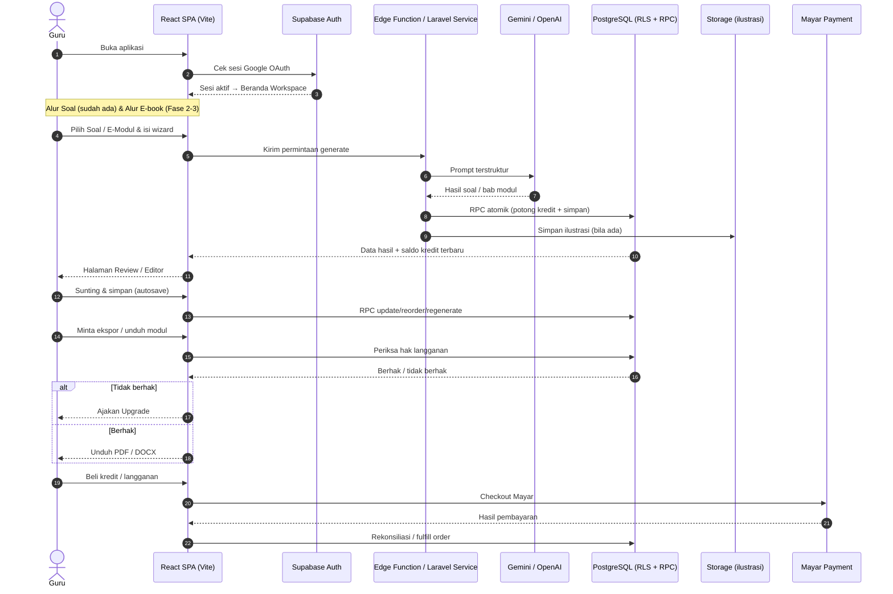
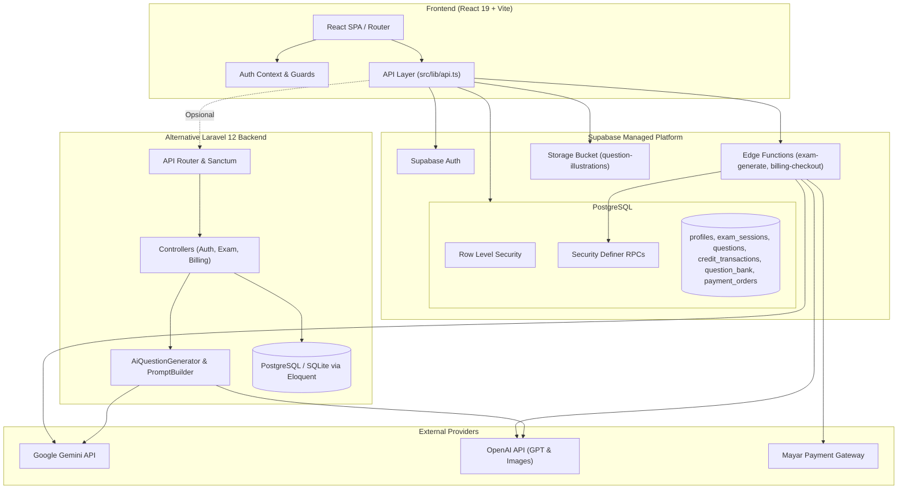
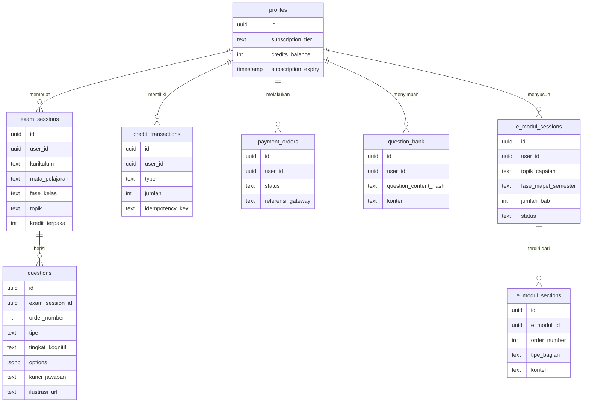

# PRD — Project Requirements Document

## 1. Overview

**Soalify** (`ardika08/buat-soal`) adalah platform pembuatan naskah soal ujian otomatis berbasis AI untuk pendidik di Indonesia.

**Masalah yang diselesaikan:**
Guru menghabiskan banyak waktu menyusun naskah ujian secara manual — mulai dari merancang soal sesuai kurikulum, memetakan tingkat kognitif (Taksonomi Bloom C1–C6), menjaga sebaran kesulitan LOTS/MOTS/HOTS, hingga merapikan dokumen siap cetak. Proses ini berulang, melelahkan, dan mudah tidak konsisten antar-naskah.

**Tujuan utama aplikasi:**
- Mengotomatiskan perancangan ujian lengkap (Pilihan Ganda, PG Kompleks, Menjodohkan, Benar-Salah, Isian Singkat, Uraian) dari topik atau dokumen referensi guru.
- Menjaga mutu naskah lewat pemetaan kognitif dan sebaran kesulitan yang tervalidasi sistem.
- Menyediakan ruang kerja untuk menyunting, menyimpan, dan menggunakan kembali soal (bank soal).
- Menyediakan ekspor dokumen siap cetak (PDF/DOCX/Kisi-kisi).
- Menjalankan monetisasi yang adil berbasis kredit dan langganan.

**Arah pengembangan (roadmap yang sudah disetujui):**
Platform diperluas dari sekadar "buat soal" menjadi ruang kerja guru yang lebih lengkap: beranda bersama untuk alur **Soal** dan **E-book**, navigasi sidebar yang rapi, serta modul baru **E-Modul/E-book** — dari penyusunan AI, penyuntingan, hingga unduh dan akses via langganan.

---

## 2. Requirements

**Persyaratan fungsional (yang sudah berjalan di codebase):**
- Autentikasi guru melalui Google OAuth (Supabase Auth) dengan proteksi rute.
- Wizard pembuatan soal 3 langkah: info dasar kurikulum, materi/referensi, dan kriteria tipe soal.
- Pemetaan kognitif Taksonomi Bloom (C1–C6) serta distribusi kesulitan LOTS/MOTS/HOTS.
- Dukungan format soal: PG, PG Kompleks, Menjodohkan, Benar-Salah, Isian Singkat, Uraian.
- Penyuntingan soal (ubah, tambah, hapus, susun ulang, regenerasi butir) dengan autosave.
- Analisis kualitas naskah ujian.
- Bank soal pribadi dengan deduplikasi berbasis sidik konten dan riwayat ujian.
- Ekspor PDF/DOCX dan kisi-kisi (DOCX serta kisi-kisi terikat status langganan premium).
- Sistem kredit: saldo awal 10 kredit, pemotongan otomatis per pembuatan soal, catatan transaksi.
- Langganan (free, basic, premium) dengan masa kedaluwarsa otomatis.
- Pembayaran via payment gateway Mayar untuk top-up kredit dan langganan.
- Pembuatan ilustrasi soal otomatis dan penyimpanannya pada storage.

**Persyaratan untuk pengembangan baru (sesuai roadmap):**
- Beranda workspace yang merangkum dua alur (Soal & E-book), saldo kredit, dan draf terakhir.
- Navigasi sidebar berkelompok (Buat Materi, Pustaka, Akun) dengan alamat halaman per modul dan mode ringkas di layar kecil.
- Wizard Generator E-Modul AI (topik, capaian, jenjang/mapel/semester, struktur bab/subbab/latihan) dengan pemotongan kredit otomatis.
- Editor E-Modul (ubah teks, autosave, susun ulang/tambah/hapus bagian, regenerasi per bagian, pemeriksaan struktur otomatis).
- Unduh Materi E-Modul (pratinjau, PDF, DOCX, format & kop modul).
- Akses E-book yang dibundel ke paket langganan, termasuk pemeriksaan hak akses dan ajakan upgrade.

---

## 3. Core Features

### A. Fitur yang sudah berjalan di platform (Soal)

- **Autentikasi & Akses**: Login Google OAuth dengan proteksi seluruh rute privat.
- **Wizard Pembuatan Soal (3 Langkah)**: Info dasar → Materi & referensi (AI/PDF/teks) → Kriteria (tipe, jumlah, topik, opsi ilustrasi) lalu eksekusi AI.
- **Pemetaan Kognitif & Kesulitan**: Distribusi Taksonomi Bloom (C1–C6) dan sebaran LOTS/MOTS/HOTS.
- **Penyuntingan & Regenerasi**: Ubah teks dan opsi, tambah/hapus/susun ulang, regenerasi butir spesifik, autosave.
- **Analisis Kualitas Naskah**: Evaluasi mutu soal sebelum dipakai.
- **Bank Soal**: Penyimpanan soal terverifikasi dengan filter (mapel, fase, topik, kesulitan, pencarian), buat paket baru, gabung ke ujian, atau hapus.
- **Riwayat Ujian**: Daftar paket soal dengan paginasi dan opsi hapus.
- **Ekspor Dokumen**: PDF, DOCX, dan kisi-kisi (DOCX landscape); ekspor lanjutan terikat langganan premium.
- **Billing & Kredit**: Top-up kredit kustom dan langganan, checkout Mayar, halaman hasil pembayaran, riwayat transaksi, dan tanda terima PDF.
- **Ilustrasi Otomatis**: Pembuatan gambar soal oleh AI dengan penyimpanan pada bucket `question-illustrations`.

### B. Fase 1 — Kerangka Ruang Kerja Guru

- **Beranda Workspace** *(high)* — Halaman utama yang merangkum dua aliran pekerjaan guru.
  - **Dua Aliran Pekerjaan** — Menampilkan dua jalur utama berdampingan: alur Soal dan alur E-book.
  - **Ringkasan Kredit & Paket** — Menampilkan sisa kredit dan status langganan memakai komponen statistik yang sudah ada.
  - **Lanjutkan Pekerjaan Terakhir** — Menampilkan draf soal dan draf e-modul terakhir.
  - **Aksi Cepat Mulai** — Tombol pintas memulai soal baru atau e-modul baru dari beranda.
- **Navigasi Sidebar** *(high)* — Menu samping berkelompok menggantikan menu atas.
  - **Grup Buat Materi** — Pintasan ke pembuatan Soal dan E-book.
  - **Grup Pustaka** — Bank soal dan riwayat ujian (disiapkan untuk materi e-book pada siklus berikutnya).
  - **Grup Akun** — Profil, kredit, langganan, dan keluar.
  - **Alamat Halaman per Modul** — Setiap modul punya alamat halaman sendiri yang dapat dibuka langsung dan dibagikan.
  - **Mode Ringkas di Layar Kecil** — Sidebar dapat dilipat otomatis di layar HP.

### C. Fase 2 — E-Modul: Penyusunan & Penyuntingan

- **Generator E-Modul AI** *(high)* — Wizard baru untuk menyusun e-modul terstruktur.
  - **Isi Topik & Capaian** — Guru menuliskan topik/capaian pembelajaran sebagai bahan dasar AI.
  - **Pilih Jenjang & Mata Pelajaran** — Menentukan fase kelas, mapel, dan semester memakai pilihan yang sudah ada di wizard soal.
  - **Atur Struktur Modul** — Mengatur jumlah bab, subbab, dan porsi latihan.
  - **Pemakaian Kredit Otomatis** — Memakai aturan pemotongan kredit dan validasi keluaran yang sudah berjalan di pembuatan soal.
- **Editor E-Modul** *(high)* — Halaman penyuntingan hasil AI sebelum diunduh.
  - **Ubah Isi Bab & Subbab** — Menyunting langsung teks bab, subbab, dan latihan.
  - **Simpan Otomatis** — Perubahan tersimpan sendiri, dengan peringatan bila halaman ditutup sebelum tersimpan.
  - **Susun Ulang & Tambah Bagian** — Memindah urutan bab, menambah bagian baru, atau menghapus bagian.
  - **Regenerasi Bagian Tertentu** — Menulis ulang satu bab atau latihan saja tanpa mengulang seluruh modul.
  - **Pemeriksaan Struktur Otomatis** — Memakai validator keluaran AI yang sudah dipakai untuk soal.

### D. Fase 3 — E-Modul: Unduh & Akses

- **Unduh Materi** *(medium)* — Mengunduh e-modul yang sudah rapi.
  - **Pratinjau Dokumen** — Melihat tampilan akhir modul sebelum diunduh (mengikuti pola pratinjau ekspor soal).
  - **Unduh PDF** — Format siap cetak maupun dibagikan digital.
  - **Unduh DOCX** — Format yang masih dapat diedit di aplikasi pengolah kata.
  - **Format & Kop Modul** — Penyesuaian tata letak dan kop identitas sekolah.
- **Akses E-book via Langganan** *(medium)* — E-book dibundel ke paket langganan yang sudah ada.
  - **Bundel E-book di Paket** — Menambah manfaat E-book tanpa membuat sistem pembayaran baru.
  - **Pemeriksaan Hak Akses** — Memeriksa hak akses guru sebelum menyusun atau mengunduh modul (mengikuti pola pemeriksaan langganan yang ada).
  - **Ajakan Upgrade** — Pengguna gratis yang mencoba E-book diarahkan ke penawaran langganan.
  - **Ringkasan Paket & Manfaat** — Penjelasan isi tiap paket dan manfaat E-book (besaran harga ditentukan pada tahap berikutnya).

---

## 4. User Flow

**Alur yang sudah berjalan (Soal):**
1. Guru membuka aplikasi → diarahkan login Google → masuk ke Dashboard.
2. Guru memilih **Buat Soal** → mengisi wizard 3 langkah → menekan generate.
3. Sistem memotong kredit dan menampilkan progres → diarahkan ke halaman Review.
4. Guru menyunting soal (autosave), menjalankan analisis kualitas, dan melakukan regenerasi bila perlu.
5. Guru menyimpan butir pilihan ke **Bank Soal** atau mengekspor dokumen (PDF/DOCX/Kisi-kisi).
6. Guru dapat meninjau **Riwayat Ujian**, membuka kembali paket lama, atau menghapusnya.
7. Guru yang butuh kredit/langganan membuka dialog Billing → checkout Mayar → kembali ke halaman hasil dan melihat riwayat transaksi.

**Alur baru sesuai roadmap:**
1. Guru login → mendarat di **Beranda Workspace** yang menampilkan dua aliran (Soal & E-book), sisa kredit, status paket, dan draf terakhir.
2. Guru memilih alur lewat **Aksi Cepat** atau **Sidebar**:
   - **Alur Soal** — mengikuti wizard pembuatan soal yang telah ada.
   - **Alur E-book** — membuka **Generator E-Modul AI**.
3. Di Generator E-Modul, guru mengisi topik/capaian, memilih fase kelas/mapel/semester, mengatur jumlah bab, subbab, dan porsi latihan → AI menyusun modul dengan pemotongan kredit otomatis.
4. Guru masuk ke **Editor E-Modul**: mengubah teks, menyusun ulang/menambah/hapus bagian, melakukan regenerasi per bagian, dan sistem memeriksa kelengkapan struktur.
5. Guru membuka **Unduh Materi**: melihat pratinjau, mengatur format & kop, lalu mengunduh dalam PDF atau DOCX.
6. Bila guru belum berhak (pengguna gratis), **Pemeriksaan Hak Akses** menahan proses dan menampilkan **Ajakan Upgrade** ke halaman paket langganan.
7. Guru yang berlangganan otomatis mendapat akses E-book sesuai **Ringkasan Paket & Manfaat**.

---

## 5. Architecture

Soalify dibangun di atas dua implementasi backend yang setara fungsinya: platform **Supabase** (dipakai oleh frontend React SPA) dan backend alternatif **Laravel 12**. Semua operasi transaksi krusial (pemotongan kredit, rekonsiliasi pembayaran, penyuntingan butir) dijalankan secara atomik lewat RPC *security definer*, bukan dari sisi klien. Pengembangan E-Modul pada roadmap mengikuti pola yang sama dengan modul Soal: wizard di frontend, proses AI di Edge Function / service backend, dan validasi keluaran yang telah ada.

Diagram arsitektur komponen (kondisi nyata aplikasi):

---

## 6. Database Schema

Skema berikut diturunkan dari entitas yang terbukti ada pada codebase. Entitas bertanda **[Baru — Fase 2/3]** disiapkan untuk mendukung modul E-Modul pada roadmap dan mengikuti pola tabel serupa yang sudah berjalan.

**Tabel yang sudah ada:**

**`profiles`** — data identitas & status akun guru.
- `id` (uuid) — identitas pengguna, terhubung ke Supabase Auth.
- `subscription_tier` (text) — tingkatan akun: *free*, *basic*, *premium*.
- `credits_balance` (integer) — saldo kredit (default 10 kredit selamat datang).
- `subscription_expiry` (timestamp) — masa berlaku langganan.

**`exam_sessions`** — satu sesi/paket ujian yang dibuat guru.
- `id` (uuid) — identitas sesi ujian.
- `user_id` (uuid) — pemilik sesi (relasi ke `profiles`).
- Kurikulum, mata pelajaran, fase/kelas, tipe ujian, alokasi waktu, topik — konfigurasi ujian.
- Konsumsi kredit — jumlah kredit yang dipakai pada sesi ini.

**`questions`** — butir soal dalam satu sesi ujian.
- `id` (uuid) — identitas butir soal.
- `exam_session_id` (uuid) — relasi ke `exam_sessions`.
- `order_number` (integer) — urutan butir.
- Tipe — format soal (PG, PGK, Menjodohkan, B-S, Isian, Uraian).
- Tingkat kognitif — C1–C6 (Taksonomi Bloom).
- Konten, `options` (jsonb) — isi soal dan opsi jawaban.
- Kunci jawaban & pembahasan.
- Prompt/URL ilustrasi — referensi gambar soal.

**`credit_transactions`** — buku besar mutasi kredit.
- `id` — identitas transaksi.
- `user_id` — relasi ke `profiles`.
- `type` — jenis mutasi: *topup*, *subscription*, *deduction*, *bonus*.
- Nominal kredit, idempotency key — pengaman agar transaksi tidak ganda.

**`payment_orders`** — log pesanan pembayaran ke gateway.
- `id` — identitas order.
- `user_id` — relasi ke `profiles`.
- `status` — *pending*, *paid*, *expired*, *failed*, *cancelled*.
- Detail paket/nominal & referensi gateway (Mayar).

**`question_bank`** — bank soal pribadi guru.
- `id` — identitas butir bank soal.
- `user_id` — pemilik soal.
- `question_content_hash` (md5) — sidik konten untuk deduplikasi.
- Salinan data soal (tipe, tingkat kognitif, konten, opsi, kunci, pembahasan).

**Tabel baru untuk mendukung E-Modul (Fase 2/3):**

**`e_modul_sessions` [Baru]** — satu sesi penyusunan e-modul.
- `id` (uuid) — identitas sesi e-modul.
- `user_id` (uuid) — relasi ke `profiles`.
- Topik/capaian, fase kelas, mata pelajaran, semester.
- Pengaturan struktur (jumlah bab, subbab, porsi latihan).
- Status draf & konsumsi kredit.

**`e_modul_sections` [Baru]** — bagian di dalam e-modul (bab/subbab/latihan).
- `id` (uuid) — identitas bagian.
- `e_modul_id` (uuid) — relasi ke `e_modul_sessions`.
- `order_number` (integer) — urutan bagian.
- Tipe bagian (bab/subbab/latihan).
- Konten teks — isi bagian hasil AI maupun suntingan guru.

> Catatan: Nama kolom teknis pada tabel lama mengikuti dokumentasi yang tersedia; sebagian field dijelaskan berdasarkan fungsinya (bukan nama kolom literal). Tabel `e_modul_sessions` dan `e_modul_sections` adalah entitas baru yang disiapkan untuk roadmap.

---

## 7. Tech Stack

Teknologi berikut diambil langsung dari codebase, bukan default.

**Frontend:**
- React 19 + TypeScript
- Vite (build tool)
- Tailwind CSS 4 / Tailwind CSS v3
- `@base-ui/react` dan `class-variance-authority` untuk komponen UI
- `@supabase/supabase-js` sebagai klien backend
- `docx` dan `jspdf` untuk ekspor DOCX & PDF
- `lucide-react` untuk ikon

**Backend Platform Utama — Supabase:**
- Supabase Auth (Email & Google Identity Services)
- PostgreSQL dengan Row Level Security (RLS)
- RPC *Security Definer* untuk transaksi atomik (mis. `create_exam_with_questions`, `fulfill_payment_order`, `update_exam_question`)
- Storage Bucket: `question-illustrations`
- Supabase Edge Functions: `exam-generate`, `billing-checkout`, `app-stats`

**Backend Alternatif — Laravel 12:**
- PHP ^8.2
- Laravel 12 (`laravel/framework`)
- Laravel Sanctum (autentikasi berbasis token)
- Eloquent ORM dengan database PostgreSQL / SQLite
- Service layer: `AiQuestionGenerator`, `PromptBuilder`, `CreditService`, `BillingService`

**Integrasi Pihak Ketiga:**
- Google Gemini API — engine untuk pengguna *free*
- OpenAI API — engine untuk pengguna *premium*, termasuk OpenAI Images untuk ilustrasi
- Mayar Payment Gateway — checkout kredit & langganan
- Rekonsiliasi pembayaran berkala melalui workflow `billing-reconcile.yml` (setiap 15 menit)